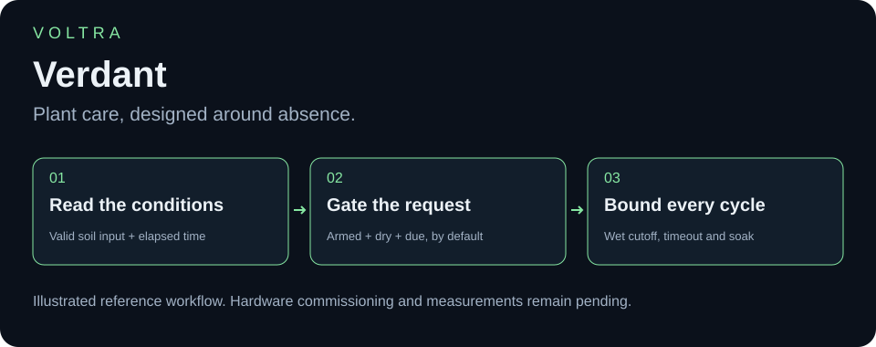
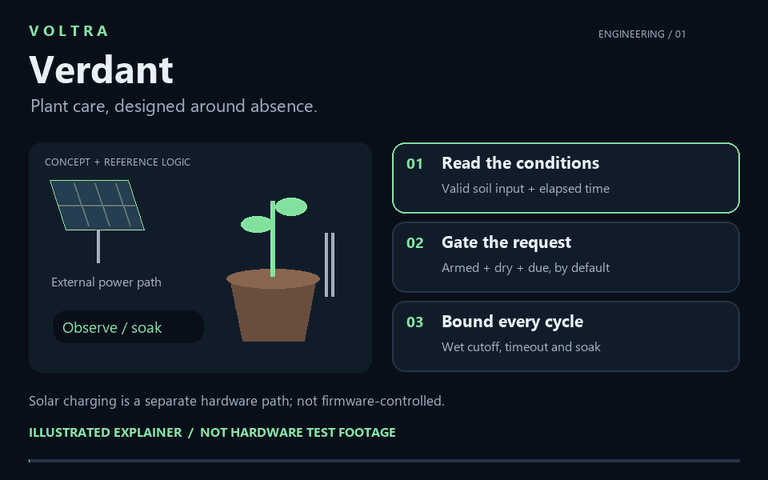
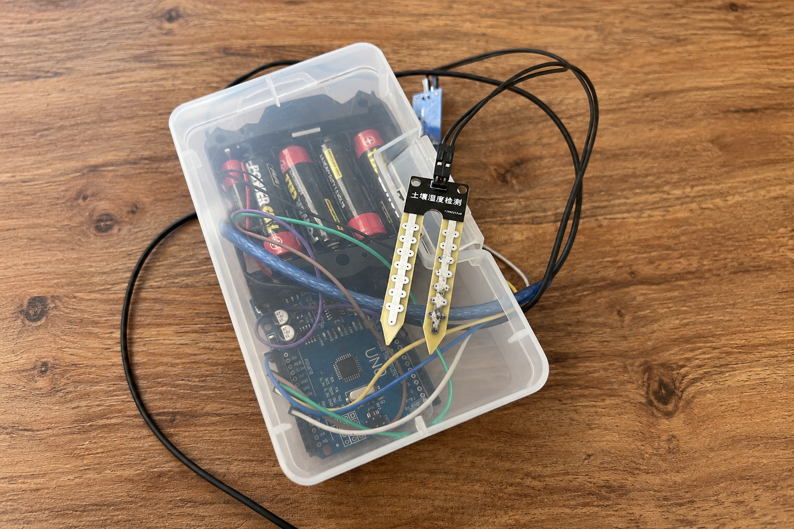
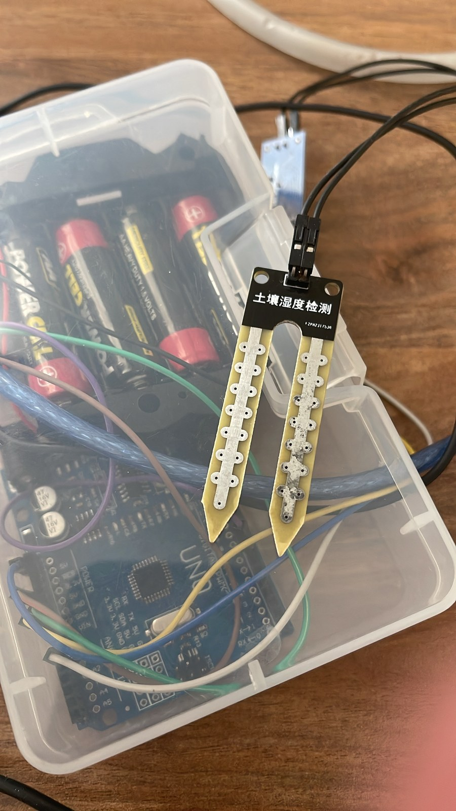
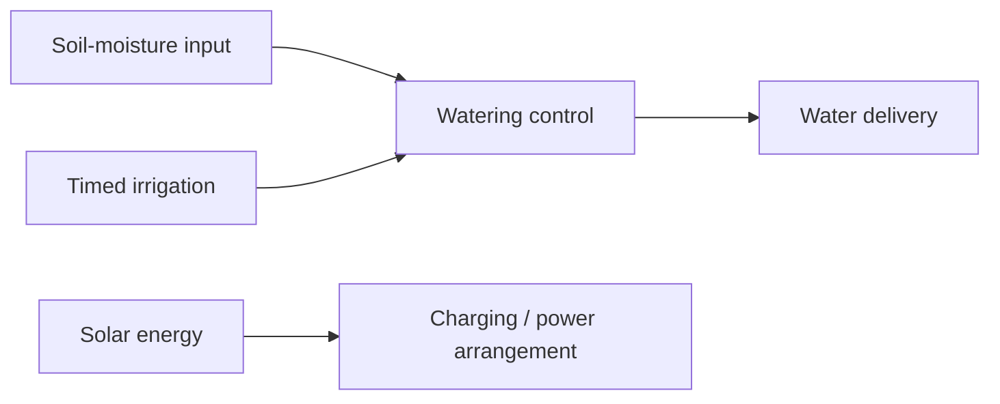

# VOLTRA Verdant

### Away from home. Still caring for what grows.

## See the idea in motion

[Watch or download the 12-second explainer](media/walkthrough.mp4). A silent, original illustration of the new reference logic—not footage of the device operating. Solar charging remains a separate hardware path, not a firmware feature. Hardware outputs are disabled by default.

## The real prototype

*Presentation image with AI-assisted background expansion; newly exposed edges and fine details are not hardware evidence. [View the original photograph](images/prototype.jpg) for the actual captured assembly.*

Original, unretouched hardware photograph

Travel should not mean coming home to neglected plants. **Solar-Powered Plant Care** is a compact irrigation prototype designed to help care for plants while their owners are away, combining **soil-moisture-based watering, timed irrigation, and solar-supported charging**.

[Features](#engineering-features) · [Hardware](#photograph-backed-component-inventory) · [Architecture](#functional-architecture) · [Source and wiring](WIRING_AND_SOURCE.md)

**New code available:** [reference firmware and build guide](FIRMWARE.md) · [actual software checks](BUILD_STATUS.md). This is newly written code with hardware disabled by default, not the firmware originally used in the photograph.

## Why this project exists

For someone leaving home, the problem is not a missing gadget—it is uncertainty about whether their plants will receive water. This project approaches that everyday problem through a small embedded system, bringing soil condition, time, and solar energy into one plant-care concept. The aim is practical assistance while owners are away; plant survival and unattended reliability still require real-world evaluation.

The project owner confirms these capabilities and that the photograph belongs to this build. The image documents the physical soil probe and controller assembly; the panel, pump, and charging circuit are not visible. Operating behavior has not yet been independently demonstrated in the supplied evidence.

## Engineering features

| Capability | Purpose | Evidence status |
| --- | --- | --- |
| Soil-moisture-based irrigation | Respond to the condition of the soil | Confirmed by owner; matching firmware and calibration needed |
| Timed irrigation | Provide scheduled watering | Confirmed by owner; interval, duration, and clock implementation needed |
| Solar-supported charging | Incorporate solar energy into the power arrangement | Confirmed by owner; panel rating and charging circuit needed |
| Compact physical prototype | Explore a small plant-care installation | Actual assembly photograph supplied |

Both irrigation modes are reported. Their precedence, interaction, and configuration are **not** inferred: the documentation does not assume whether a timer overrides moisture, moisture gates a schedule, or the modes are selected separately.

## Photograph-backed component inventory

| Visible item | Quantity | Identification boundary |
| --- | --- | --- |
| Exposed-electrode soil probe | 1 | Exact model, interface board, and calibration unknown |
| Arduino / Uno-format controller board | 1 partially visible | Exact board and MCU marking not confirmed |
| Battery holder / cells | 1 visible holder | Chemistry, cell count, capacity, charging arrangement unknown |
| Wiring and enclosure | Present | Complete circuit not visible |

## Functional architecture

*Owner-reported functional architecture, not an electrical schematic. The charging circuit, power connections, timer mechanism, and actuator implementation still require the original design.*

## Code and connections

The original sketch was not located. At the owner's request, a **new reference implementation** now provides three irrigation modes, wet/dry hysteresis, run-time limits, soak intervals, fault handling and manual arming. Its new combined mode requires both a due timer and dry soil; the original build's mode interaction is still unknown. Read the [firmware guide](FIRMWARE.md) before using it. Actual wiring/calibration remains a separate [hardware checklist](WIRING_AND_SOURCE.md).

## What makes the next demonstration meaningful

Identify the panel, pump, controller, and supply ratings; document whether solar energy powers the load directly or charges storage. Supply the original sketch and actual wiring. Record the trigger condition and genuine water flow, along with the power source used during the test.

No water-saving percentage, autonomous runtime, solar charging success, irrigation volume, or moisture accuracy is currently claimed. Reproducible build instructions depend on the missing electrical and control details.

Project author: [ali9235](https://github.com/ali9235). New reference firmware; physical commissioning remains pending. No project-wide license selected.
