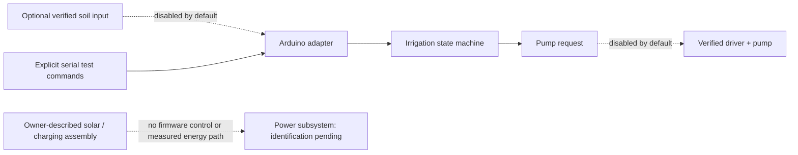

# VOLTRA Verdant: architecture and technical deep dive

Make a small solar plant-care experiment understandable and testable before trusting it while travelling. The owner identifies the physical concept as watering and charging; unattended endurance and charging safety have not been demonstrated.

## System boundary

Solid arrows show implemented software flow or observed grouping. Dashed arrows identify optional, disabled or unverified paths. Neither is a recovered wiring schematic.

## Source and processing contract

| Layer | Source | Responsibility |
| --- | --- | --- |
| Configuration | [config.h](../firmware/plant_care/config.h) | Hardware gates, calibration values and driver-verification checks |
| Policy | [irrigation.h](../firmware/plant_care/irrigation.h) | Percentage conversion and Controller state |
| Adapter | [plant_care.ino](../firmware/plant_care/plant_care.ino) | Serial commands, optional ADC and gated GPIO output |
| Verification | [test_core.cpp](../tests/test_core.cpp) | Deterministic core checks, not a pump test |

Valid ADC readings are linearly mapped between dry/wet calibration values and clamped to 0–100%. ADC endpoints, invalid calibration and invalid moisture values do not become plausible readings. Default mode requires both an elapsed interval and dry soil. The controller starts disarmed, applies start/stop hysteresis, enforces a soak period and limits requested run duration. Invalid sensing latches a fault and disarms.

The policy API comprises begin(now), tick(now, moisture), arm(), disarm(now), resetFault() and read-only state accessors. Units are unsigned milliseconds and percentage estimates. There is no HTTP/cloud API. Serial a/x/r requests arming, stop and reset; d/w/m/f supplies explicitly simulated soil when real input is disabled.

The default 35/65% thresholds, six-hour interval, one-minute soak and five-second run limit are reference policies, **not plant-specific recommendations**. Timing is relative to boot. There is no RTC, persistent schedule, tank/flow sensing, dry-run protection or independent hardware cutoff. Solar charging is outside this firmware.

## Evidence boundary

No unattended travel trial, delivered water volume, battery runtime, charge efficiency or physical pump actuation was measured.

[Documentation index](ENGINEERING_STANDARD.md) · [Design decisions](DECISIONS.md) · [Security](../SECURITY.md)
